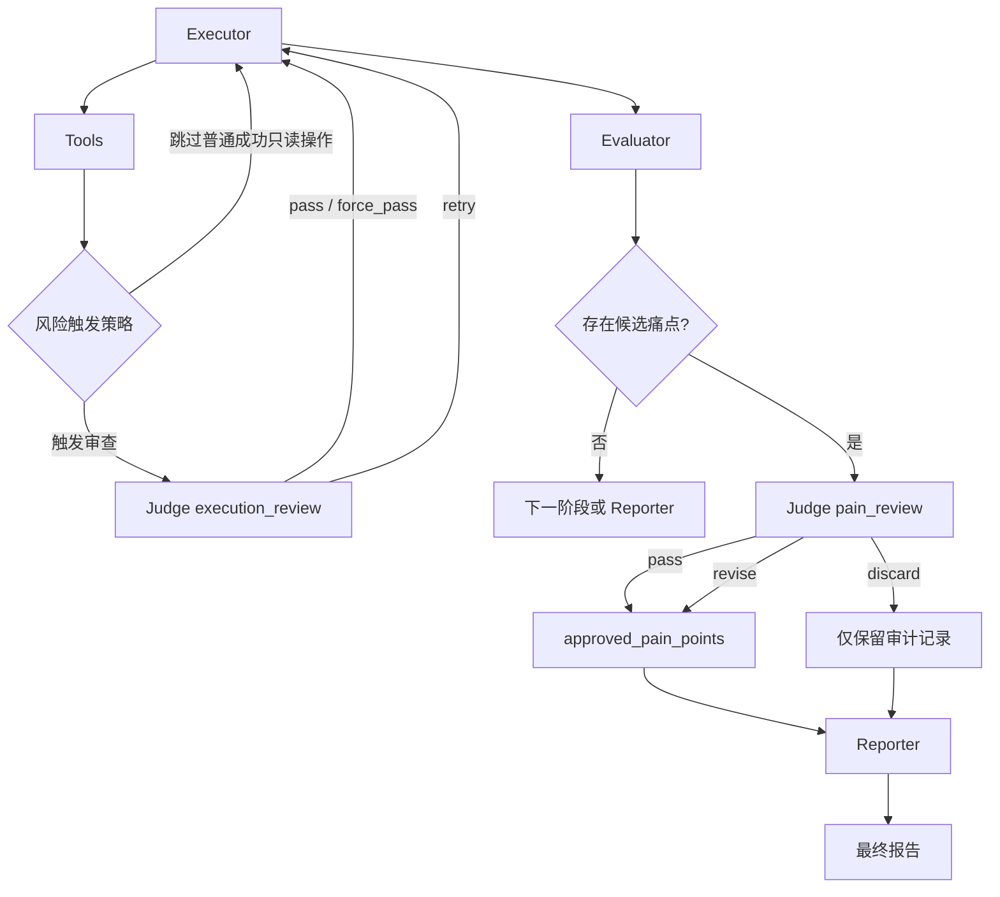

# 独立 Judge 节点架构

**版本**：1.0.0  
**文档状态**：正式版  
**最后更新**：2026-08-03  
**适用范围**：当前 DevX Agent 工作流中的 Judge 节点

## 1. 文档目的

本文只描述 Judge 在当前 Agent 中的架构位置、职责边界和数据流，不重复介绍整个 DevX Agent 的通用架构，也不定义评分机制。

Judge 的最终目的只有一个：

> 防止 Agent 操作错误、运行环境问题、外部依赖问题或证据不足，被错误包装成项目问题并写入最终报告。

Judge 是工作流中的一个独立 LangGraph 节点。`PainJudge` 不是另一个节点，而是 Judge 节点内部的 `pain_review` 处理分支。

## 2. 在总体架构中的位置

按照 [`architecture.md`](./architecture.md) 的分层方式，Judge 属于编排层与 Worker 业务层之间的业务节点：

```text
DevXWorkflowBuilder
        │
        ▼
   StateGraph
        │
        ├── planner      生成任务
        ├── executor     决策并执行 Agent 行为
        ├── tools        执行真实工具
        ├── evaluator    生成候选观察和候选痛点
        ├── judge        独立裁决节点
        └── reporter     生成最终报告
```

Judge 不替代 Executor、Evaluator 或 Reporter：

| 组件 | 负责内容 | Judge 的关系 |
|---|---|---|
| Planner | 生成开发者旅程任务 | Judge 不重新规划任务 |
| Executor | 选择工具、组织操作、处理结果 | Judge 审查其操作是否合理 |
| Tools | 执行 Shell、文件、浏览器等工具 | Judge 使用工具事实作为证据 |
| Evaluator | 从事实生成候选观察和痛点 | Judge 审查候选痛点的真实性和责任归属 |
| Reporter | 汇总并输出报告 | Reporter 只能使用 Judge 放行的数据 |

## 3. 核心数据流



Judge 有两个处理时机，但只有一个节点实现：

| `judge_stage` | 调用时机 | 主要问题 | 结果 |
|---|---|---|---|
| `execution` | 工具调用完成后 | Agent 是否正确执行，失败由谁负责 | `pass`、`retry`、`force_pass` |
| `pain` | Evaluator 产生候选痛点后 | 候选问题是否是可归因于项目的真实痛点 | `pass`、`revise`、`discard` |
| `pain_reviewed` | 当前阶段痛点评审完成后 | 为后续路由标记已完成审查 | 路由到下一阶段或 Reporter |

## 4. Judge 节点的职责

### 4.1 执行审查：`execution_review`

执行审查检查最近一次工具调用及其任务上下文，主要防止 Agent 因为错误操作制造虚假问题。

Judge 重点检查：

- 工具名称、参数、路径和命令是否符合已读取的项目文档；
- 是否在前置步骤失败后盲目执行后续步骤；
- 是否重复执行相同失败操作；
- 失败是否由 Agent、项目、环境或外部依赖导致；
- 工具输出是否足以支持任务成功或失败结论；
- 是否需要让 Executor 修正操作后重试。

典型结果：

```text
正确执行或责任不属于 Agent  → pass
参数/路径/顺序错误           → retry
达到重试上限或 Judge 不可用   → force_pass，并记录风险
```

### 4.2 痛点评审：`pain_review`

痛点评审是 Judge 防止“非项目问题进入报告”的核心环节。Evaluator 只能提交候选痛点，不能直接决定最终报告内容。

Judge 必须同时检查：

1. 是否存在明确失败、阻塞或体验损失事实；
2. Agent 是否基本遵循了项目文档和任务要求；
3. 是否有项目代码、项目文档、构建配置或项目流程证据；
4. 是否排除了环境、权限、网络、驱动、硬件、第三方依赖等因素；
5. 痛点描述是否具体，影响范围是否被夸大。

判定含义：

| 判定 | 含义 | 是否进入正式报告 |
|---|---|---:|
| `pass` | 事实充分且责任归属于项目 | 是 |
| `revise` | 事实成立，但描述或责任归因需要修正 | 使用修订后的内容 |
| `discard` | Agent、环境、外部依赖或证据不足 | 否 |

## 5. 责任归因模型

Judge 的核心不是判断“有没有报错”，而是判断“谁应为这个问题负责”。

```text
project    项目代码、文档、配置或流程问题
agent      Agent 命令、参数、路径或操作错误
environment 本机环境、权限、网络、驱动、硬件问题
external   第三方服务、依赖或外部组件问题
unknown    证据不足，无法可靠归因
```

只有 `project` 责任的问题可以成为正式项目痛点。`unknown` 默认不放行，但必须保留完整审计信息，便于人工复核。

证据优先级固定为：

```text
安全/破坏性规则
  > 项目文档明确证据
  > 工具执行事实
  > 项目源码、构建脚本和配置
  > 非项目问题知识库
  > LLM 推断
```

知识库只能作为辅助证据，不能覆盖当前运行中新的项目级事实。

## 6. 输入与输出契约

### 6.1 输入

Judge 从 `WorkflowState` 读取：

- `judge_stage`：当前审查阶段；
- `last_tool_result`：最近一次工具结果；
- `tool_history`：当前任务的完整工具调用历史；
- 当前任务、阶段和项目上下文；
- Agent 实际读取到的文档和浏览器证据；
- Evaluator 产生的候选痛点；
- Judge 历史判决和任务级重试次数；
- Judge 配置、策略和知识库路径。

### 6.2 输出

执行审查至少写入：

```json
{
  "judge_verdict": {
    "decision": "pass | retry | force_pass",
    "correct": true,
    "reason": "可验证的判定理由",
    "responsibility": "agent | project | environment | external | unknown",
    "evidence": ["命令输出或文档证据"],
    "confidence": 0.0
  },
  "judge_retry_instruction": "仅 retry 时填写",
  "judge_trigger_reasons": ["tool_failure"],
  "judge_trigger_command_class": "build"
}
```

痛点评审至少写入：

```json
{
  "judge_pain_decisions": [
    {
      "decision": "pass | revise | discard",
      "original_content": "Evaluator 原始候选",
      "content": "最终允许使用的内容",
      "responsibility": "project | agent | environment | external | unknown",
      "evidence": ["项目文档或运行事实"],
      "reason": "判定理由"
    }
  ],
  "judge_approved_pain_points": ["只有 pass 或 revise 的项目痛点"]
}
```

`judge_approved_pain_points` 是 Reporter 在 Judge 模式下唯一允许使用的正式痛点来源。

## 7. 触发与路由

### 7.1 执行审查触发

以下情况必须触发 Judge：

- 任意工具失败；
- 任务最终失败，需要回看完整工具链；
- 构建、运行、安装、下载、环境设置、修改或删除操作；
- 影响文档证据或责任归因的文件读取、搜索或浏览器操作；
- 返回空结果、未找到结果或关键参数由搜索结果决定。

普通成功只读操作可以跳过，但跳过不能覆盖失败、证据影响或责任归因审查。

### 7.2 路由规则

`route_after_judge` 根据 `judge_stage` 和判决结果路由：

```text
execution + retry       → executor
execution + pass        → executor，继续处理工具结果
execution + force_pass  → executor，带风险记录继续
pain + retry 需求       → executor，重新完成任务
pain + reviewed         → 下一阶段或 reporter
```

Judge 不直接调用工具，也不直接修改项目文件。它只能通过状态中的判决和修正指令影响 Executor 的下一步行为。

## 8. Reporter 门禁

Reporter 必须先对 Judge 状态进行清洗：

1. Judge 开启时，丢弃未审核的候选痛点；
2. 只读取 `judge_approved_pain_points`；
3. `discard` 结果只留在审计日志和 `judge_pain_decisions`；
4. Judge 未完成痛点评审时，不得默认把候选痛点放行；
5. 保留原始事实与裁决结果的关联，支持报告追溯。

因此，数据流必须满足：

```text
Evaluator 候选痛点
        │
        ▼
Judge 审核/修订/丢弃
        │
        ├── judge_pain_decisions（完整审计）
        └── judge_approved_pain_points（Reporter 门禁输入）
```

## 9. 可靠性与降级

Judge 的失败不能导致 Agent 无限循环，也不能静默制造结论：

- 单任务重试次数由 `judge.max_retries` 和 `task_retry_counts` 限制；
- 同一失败操作反复出现时，停止盲目重试并记录风险；
- Judge 超时、LLM 不可用或响应无法解析时，执行审查使用 `force_pass`；
- 痛点评审无法验证时，候选痛点不得自动升级为正式项目问题，应标记为未验证或丢弃；
- 所有降级都要写入 `judge_metrics`、审计日志和轨迹。

## 10. 可观测性

每次 Judge 调用至少记录：

- 审查阶段和任务 ID；
- 触发原因与命令分类；
- 输入摘要、工具历史和证据来源；
- LLM 请求、响应解析状态和耗时；
- 最终判决、责任归属、置信度和重试次数；
- 痛点评审的原始内容、修订内容或丢弃原因。

`judge_trajectory` 使用 action-observation 形式记录 Agent 操作和工具观察，支持复盘“Agent 做了什么、工具返回了什么、Judge 为什么这样判”。

## 11. 实现映射

| 架构职责 | 当前实现 |
|---|---|
| 节点创建与统一调度 | `src/workflow/nodes.py:create_judge_node` |
| 工作流注册与边 | `src/workflow/workflow.py` |
| 执行后路由 | `src/workflow/routing.py:route_after_judge` |
| 执行触发策略 | `src/workers/judge/trigger_policy.py` |
| 判定策略接口 | `src/workers/judge/strategies/base.py` |
| 文档一致性策略 | `src/workers/judge/strategies/doc_conformance.py` |
| 非项目问题知识库 | `src/workers/judge/knowledge_base.py` |
| 轨迹构建 | `src/workers/judge/trajectory.py` |
| Reporter 门禁 | `src/workers/reporter/worker.py` |
| 状态字段定义 | `src/workflow/workflow.py:WorkflowState` |

## 12. 设计边界

Judge 明确不负责：

- 生成完整评估计划；
- 替代 Executor 进行工具选择；
- 修复项目代码或环境；
- 重新执行工具调用；
- 计算或调整项目评分；
- 编造不存在的项目证据；
- 将证据不足的问题强行归因给项目。

Judge 只负责裁决、归因、给出必要的重试指令，以及为 Reporter 提供经过审核的结果。

## 13. 变更同步要求

任何以下变更都必须同步更新本文档、`docs/judge_node_design.md`、相关测试和实现：

- Judge 触发条件或路由；
- `WorkflowState` 中的 Judge 字段；
- 判决枚举、责任归因或降级规则；
- Reporter 的数据门禁；
- 审计日志、轨迹或知识库输入；
- Judge 策略、提示词和配置。

完成标准是：架构文档、实现、测试和真实运行日志对 Judge 行为的描述一致。
