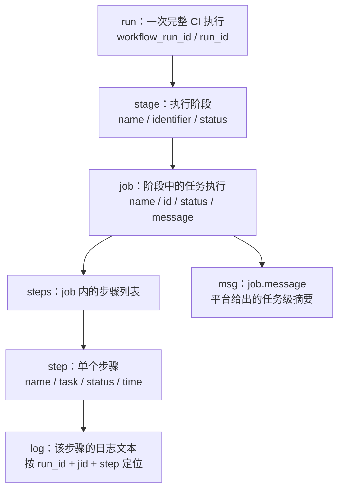

# CI Agent 分类输入中的 run、stage、job、step、msg 关系

本文从 **CI Agent 的数据处理角度**说明一次流水线执行里的对象如何关联，以及分类器如何从这些对象中选出一条 run 的主失败证据。

## 第一部分：run、stage、job、jid、step、msg 与日志

### 1. 对象关系



可以把层级读作：**一次 run 包含多个 stage；一个 stage 下有多个 job；一个 job 包含多个 step。** `msg` 是挂在 job 上的平台摘要；日志是 step 执行时产生的文本。它们描述同一次失败，但不是同一个字段。

### 2. 字段分别表示什么

| 字段 | 所属对象 | CI Agent 中的含义与用途 |
|---|---|---|
| `run_id` | run | 一次流水线执行的标识。原始详情里的字段名是 `workflow_run_id`；写入 `labeled` 时保存为 `run_id`。它把这次 run 与其下的 stage、job 和日志目录关联起来。 |
| `stage` | stage | 阶段名称，例如 `Compile`、`UT`、`PreSmoke`。分类会将名称归一到阶段家族，再结合阶段判断适用的规则。`stage.identifier` 是平台阶段标识；若 `stage.name` 被遮蔽，读取阶段会尝试用同仓 `identifier` 对应的明文名称恢复。 |
| `job` | job | 阶段内实际执行的任务名称。矩阵任务可能有组名和变体名；`labeled.job` 保存分类使用的变体名，便于识别具体任务。 |
| `jid` | job | `job.id`，即该次 job 执行的 ID。它不是 run ID，也不是另一层任务；CI Agent 用它定位这次 run 下的具体 job，并拼出日志路径。 |
| `step` | step | 被选中 job 中的具体步骤名称，例如 `compile_acc` 或 `ut`。原始 step 还带有状态、任务标识和起止时间；分类记录保存主归因所选 step 的名称。 |
| `msg` | job | 这里指原始字段 `job.message`，由平台附在 job 上，概括该任务的失败信息；它不是日志正文。部分固定平台错误可直接由 `msg` 命中；常见的“点击任务查看详情”类消息只说明步骤失败，不能代替日志根因。 |
| 日志 `log` | step 的执行输出 | 保存为独立文本文件，不嵌在 `msg` 里。失败步骤的日志尾按 `data/logs/{repo}/{run_id}/{jid}_{step}.tail.txt` 定位，提供更具体的错误行供规则匹配。 |

`stage/job/jid/step/msg` 描述的是**失败发生在哪里、平台报告了什么**；`cls`（大类责任归属）和 `mech`（具体失败模式）是 CI Agent 根据这些证据算出的**分类结果**，不是平台对象层级中的字段。

### 3. CI Agent 怎样从一个 run 选出主归因

原始 run 详情按 `stages → jobs → steps` 组织。首轮分类大致按以下顺序处理：

1. 遍历 run 里的 stage 和 job，只把带有 `steps` 的 job 当作可归因的叶子 job。
2. 从叶子 job 中筛出 `status == FAILED` 的 job。没有失败叶子 job 时，结果为“待定 · 无失败叶子 job”。
3. 比较每个失败 job 中失败 step 的最早 `end_time`；缺少失败 step 结束时间时，回退到 job 的 `end_time`。选择最早失败的 job。
4. 在选中 job 的 step 列表里取第一个 `FAILED` step。
5. 从这组证据写出 `stage`、`job`、`jid`、`step`、`msg`；随后按判定顺序检查平台消息、日志以及阶段和步骤规则。

所以一条 `labeled` 记录是 **run 的主失败归因记录**，不是 run 下所有 job 的逐条清单。一个 run 即使有多个失败 job，首轮仍只选一个最早失败的 job/step 作为主归因；后续的系统性检查等逻辑可以再查看同一 run 的其他失败 job。成功 run 不写成失败标签，但可在 Flaky 复判中作为同 PR、同代码重跑转绿的证据。

### 4. 一个 labeled 行怎么读

以下是字段关系示意：

```text
run_id = <这次流水线执行的 ID>
stage  = Compile
job    = CodeCheck_style
jid    = <该 job 本次执行的 ID>
step   = codecheck
msg    = 步骤codecheck执行失败，错误信息：点击任务查看详情
```

阅读顺序是：先用 `run_id` 找到这次流水线，再看它所属的 `stage`；`job` 是被选作主归因的任务名称，`jid` 精确指出该任务的这次执行；`step` 指向 job 内失败步骤；`msg` 是平台给这个 job 的摘要。若 `msg` 太笼统，分类器就依据 `run_id + jid + step` 找到对应日志，继续检查实际错误内容。

### 5. 代码对应位置

- 原始字段投影：`observation/parser/project.py` 的 `project()`。
- run 详情读取、阶段名称恢复和叶子 job 遍历：`observation/parser/classify.py` 的 `load_details()`、`_unmask()`、`leafs()`。
- 主失败 job/step 的选择及 `stage/job/jid/step/msg` 组装：`observation/parser/classify.py` 的 `classify_run()`。
- 按 `run_id + jid + step` 读取日志尾：`observation/parser/classify.py` 的 `log_tail()`。
