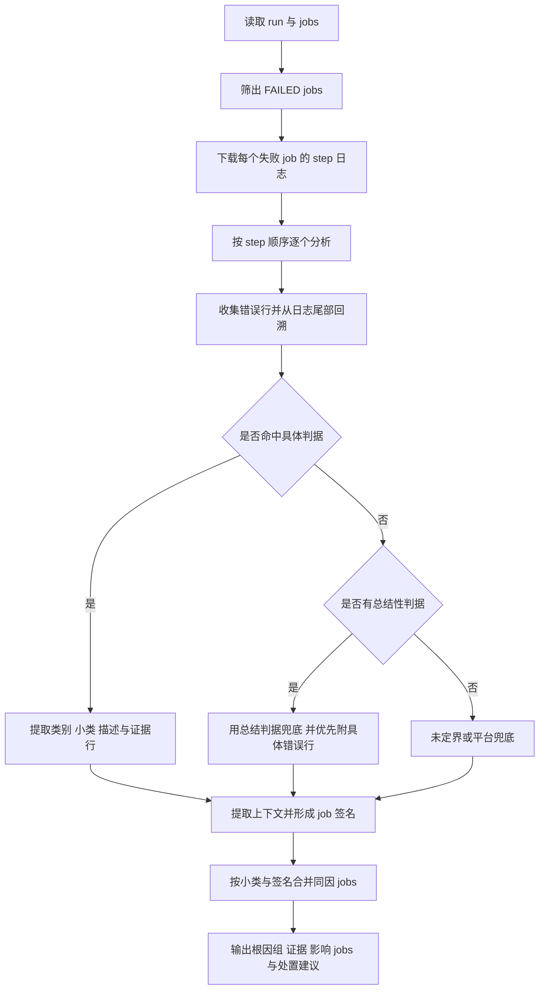

# Pipeline 判据与 CI 根因结果融合方案

> 本文是融合方案说明，不改变现有 CI 分类器或指标口径。它聚焦 Pipeline 现有的单次 run 分析链路：**判据匹配 → 从日志提取证据 → 生成 run 级根因结果 → 合并同因 job → 输出报告**。这里的“根因结果”是一次运行的分析结果，不是生成或写入 CI 的 `MECHS`。

## 1. Pipeline 当前如何从判据得到根因结果

判据库 `rules.json` 不只是正则列表。它按大类、小类组织规则，并可包含判据描述模板、`generic` 标记、日志上下文提取规则及兜底标记。分析脚本按这些结构执行。



### 1.1 逐 job、逐 step 找到可解释的失败

`analyze_run.py` 先选出状态为 `FAILED` 的 job，逐个下载其 step 日志。`analyze_job()` 按脚本定义的 step 顺序分析：遇到第一个可定界的结果就采用并停止继续找；如果所有 step 都未能定界，则保留先得到的结果。

每个 step 的日志交给 `analyze_log.py`：

1. 特定的测试日志截断或挂起形态可以直接生成对应结果。
2. 否则收集日志中的错误行，从尾部往前检查最近最多 3000 个候选行；忽略噪声和通用错误行，最多实际检查 200 个有效候选。
3. 每个候选行按规则库的大类、小类和规则排列顺序匹配。先找具体判据；命中后立即采用该结果。
4. `generic` 规则代表汇总性错误。先记下它，但继续往前寻找更具体的报错；没有具体命中时才用它兜底，并尽量把更具体的错误行作为证据。
5. 某些判据可配置上下文提取，例如从命中行附近抽取文件名、用例名或参数列表。日志没有匹配到时，结果保留为未定界或适用的兜底结果，不凭空编造根因。

规则匹配返回大类、小类、规则描述和命中日志行。若正则含捕获组，捕获值会填入描述模板；因此报告里的根因短句主要由**判据描述模板 + 日志捕获值**组成，证据则来自日志原文及配置的上下文。对应实现分别在 `pipeline-skill/gate-failure-analysis/scripts/analyze_log.py` 的 `match_rules()` 和 `pipeline-skill/gate-failure-analysis/scripts/analyze_run.py` 的 `analyze_job()`。

### 1.2 从单 job 结果合并成 run 级根因组

单 job 分析会同时得到根因签名：优先从规则描述或证据中提取算子名；否则尝试取文件路径；再否则使用证据文本片段。run 级报告按 **小类 + 签名** 对失败 job 分组，同组保留受影响的 job、step、规则描述和证据。

因此，一个 run 可以有多个根因组；多个 job 若命中同类、同签名的错误，则报告为一个根因组并列出所有受影响 job。还有少数明确的连带关系规则，例如同一 run 已有 PR 冲突时，把由冲突引起的 checkout 失败并入冲突组。对应实现是 `pipeline-skill/gate-failure-analysis/scripts/analyze_run.py` 中的 `build_report()` 与 `_merge_conflict_followups()`。

最终 Markdown/JSON 报告中的信息来源如下：

| 报告内容 | 来源 |
|---|---|
| 大类、小类 | 命中的规则分类；必要时按 job 名覆盖细化 |
| 根因短句 / 判据描述 | `rules.json` 的 `desc` 模板，结合正则捕获值 |
| 根因证据 | 精确命中的日志行，及判据配置的上下文 |
| 影响 job、step、耗时 | run/job/step 元数据与逐 job 分析结果 |
| 同因归组 | 小类与根因签名 |
| 处置建议 | 按大类配置的建议及少数专门分支，不是自由生成的因果推理 |

所以，Pipeline 脚本的“根因分析”本质上是**用规则确定失败类型，用日志行支撑结论，再把同因 job 汇总成报告**。Coding Agent 可以核对日志、处理多根因或证据矛盾等情况；脚本本身不根据整段日志自由推演任意根因。

## 2. 实例：ops-nn run#8355

`rules.json` 中有一条规则，正则从异常行中捕获 `op_name`，描述模板为“算子 `{0}` 编译失败：TBE 参数校验异常”。判据位于 `pipeline-skill/gate-failure-analysis/references/rules.json`。

日志证据包含：

```text
Exception occured, ({'errCode': 'E80003', 'op_name': 'group_norm_swish',
... "the parameter[num_groups]'s type should be [int], but actually is [dict]."})
```

处理过程：

1. 正则命中该日志行，捕获 `group_norm_swish`。
2. 模板填充值，形成“算子 group_norm_swish 编译失败：TBE 参数校验异常”。
3. 命中行作为证据，说明 `num_groups` 期望类型是 `int`，实际类型是 `dict`。
4. 其他编译 job 命中同一小类和签名时，合并进同一根因组。
5. 报告列出三个受影响的编译 job、判据描述和原始证据，并按“代码问题”给出通知 PR 提交者修复的处置建议。报告样例位于 `pipeline-skill/gate-failure-analysis/SKILL.md`。

这个例子里，脚本输出的根因短句来自规则模板，具体参数类型错误来自日志。它没有仅凭“编译失败”这个结果猜测更深层的代码位置或开发者意图。

## 3. 融入 CI 方案时的分层

建议把 Pipeline 这条**单次失败的日志分析与报告生成链路**纳入 CI 融合方案，作为分类结果的证据解释层：

```text
CI run / job / step 原始数据
          │
          ├─ 现有 classify.py：按既有判据产出 cls、mech，供 labeled 与指标统计
          │
          └─ Pipeline 式日志分析：规则匹配 → 命中行/上下文 → job 根因结果
                                     → 根因签名 → run 内同因 job 聚合 → 分析报告
```

接入设计应保留 Pipeline 输出的来源链：每个根因组至少能回指**命中的规则、日志文件/step、原始证据行、捕获值、签名及受影响 job**。没有具体判据命中时，输出未定界和可见证据，不把总结性错误包装成已证实的根因。

这条报告链与 CI 的 `cls` / `mech` 分类字段各自回答不同问题：前者给出**这个 run 的日志如何支持一条失败结论**；后者是现有分类器和统计管道使用的分类键。把 Pipeline 结果接入报告，不会自动新增或改写 `MECHS`，也不意味着 Pipeline 的类别可以未经验证直接替代 CI 的 `cls` / `mech`。

## 4. 融合时要保留的判定约束

1. **具体错误优先于汇总错误**：保留 Pipeline 对 `generic` 汇总判据的后备定位方式，避免把 `make failed`、`UT failed` 直接当作最深层根因。
2. **判据顺序是结果的一部分**：类别、小类、规则的顺序和 job 覆盖会改变首次命中结果，移植时须明确保存并验证顺序。
3. **证据和结论同组输出**：根因短句旁保留原始命中行和上下文，使读者能从结论回到日志核对。
4. **保留未定界分支**：无命中时明确输出未定界；规则命中只能解释它覆盖的现象，不代表已追到日志之外的更深层原因。
5. **run 内聚合，不把多个独立根因揉成一个**：使用小类和签名合并同因 job；不同签名保留为不同根因组。
6. **处置建议与证据分开**：Pipeline 的处置建议来自类别模板或专门分支，不能把建议反写成已证实的根因事实。

## 5. 方案验证方式

在小样本上验证 Pipeline 式结果链路时，逐 run 检查：

- 选取的确实是失败 job，日志覆盖了待分析的 step。
- 每个具体命中可定位到规则、step 和原始证据行；捕获值填入模板正确。
- 具体错误优先于后续汇总错误，`generic` 只在无具体命中时兜底。
- 同因 job 被合并，独立签名没有被错误合并；未命中的日志保持未定界。
- 报告中的 job、step、证据和处置建议分别对应各自来源。

规则通过这些检查后，才适合接到更大范围的 CI 报告流程；这一步验证的是**日志匹配和根因报告是否忠实于证据**，不更改既有历史指标口径。

## 6. Pipeline 代码入口

- `gate-failure-analysis/scripts/analyze_run.py`：run/job 日志下载、逐 job 分析、签名分组与 Markdown/JSON 报告。
- `gate-failure-analysis/scripts/analyze_log.py`：错误行回溯、判据顺序匹配、捕获值替换、上下文抽取和兜底。
- `gate-failure-analysis/references/rules.json`：分类、正则、描述模板及上下文配置。
- `gate-failure-analysis/SKILL.md`：`ops-nn run#8355` 报告样例，以及 Agent 核对日志证据的工作约定。
